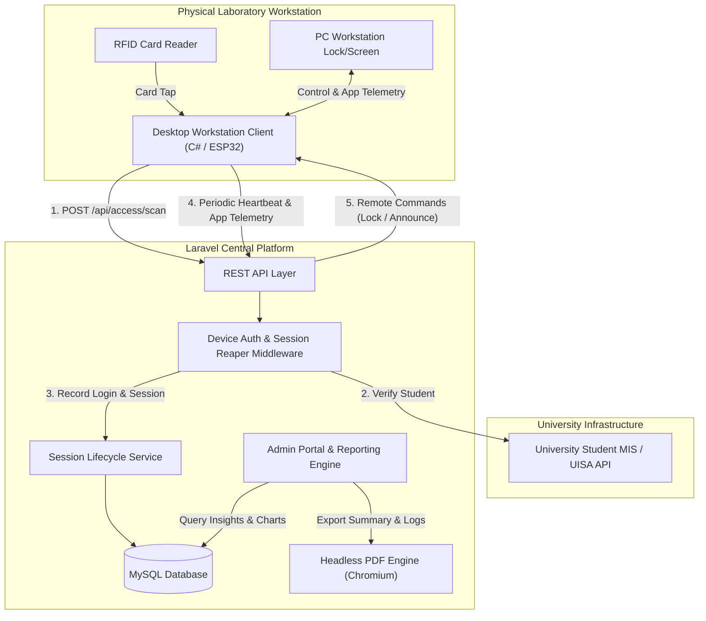

# IoT Workstation Access Control & Laboratory Management System

[](https://laravel.com)
[](https://php.net)
[](https://tailwindcss.com)
[](https://flowbite.com)
[](https://apexcharts.com)
[](LICENSE)

An enterprise-grade IoT access control, workstation monitoring, and analytics platform designed for university computer laboratories and library digital research centers. The system pairs physical workstation clients and RFID/NFC hardware with a central Laravel cloud engine to authenticate users, manage workstation sessions, track foreground application usage, and generate institutional compliance reports.

---

## Table of Contents

- [Key Features](#key-features)
- [System Architecture](#system-architecture)
- [Tech Stack](#tech-stack)
- [Hardware & IoT Integration](#hardware--iot-integration)
- [Interactive Reporting Engine](#interactive-reporting-engine)
- [Role-Based Access Control (RBAC)](#role-based-access-control-rbac)
- [Getting Started](#getting-started)
  - [Prerequisites](#prerequisites)
  - [Installation](#installation)
  - [Environment Configuration](#environment-configuration)
  - [Database Setup & Migrations](#database-setup--migrations)
  - [Running the Application](#running-the-application)
- [API Reference](#api-reference)
  - [Client & Device Endpoints](#client--device-endpoints)
- [Project Directory Structure](#project-directory-structure)
- [Contributors](#contributors)
- [License](#license)

---

## Key Features

### 1. RFID Contactless Authentication & Student MIS Integration
- **Zero-Friction Access**: Students tap their RFID/NFC smart cards on hardware readers to instantly unlock computers.
- **University MIS Gateway (`MisStudentLookup`)**: Validates card serials against the university student database in real-time to fetch student numbers, complete names, and degree programs.
- **Audit Logging**: Every access attempt—both allowed check-ins and denied attempts—is timestamped and tied to the workstation hardware.

### 2. Workstation Session Management & Auto-Reaping
- **Session State Tracking**: Pairs distinct `time_in` and `time_out` events under a unified session ID for precise duration tracking.
- **Heartbeat & Telemetry**: Workstations transmit periodic pings to report live status (`online`, `idle`, `occupied`, `stale`).
- **Automated Stale Session Reaper (`SessionService`)**: Detects disconnected computers or abnormal power-offs and automatically finalizes orphan sessions with system-logged reasons.
- **Remote Commands**: Admins can broadcast remote lock commands, sound announcements, or force-end active sessions from the central web dashboard.

### 3. Application Usage Monitoring (`pc_app_usage`)
- Desktop workstation clients capture and transmit foreground software usage (e.g., Visual Studio Code, Chrome, AutoCAD, Word).
- Displays granular software popularity and duration metrics to analyze lab utility and license demand.

### 4. Advanced Multi-Step Reporting Wizard & Visual Analytics
- **4-Step Wizard**: Guides administrators through report configuration:
  1. **Report Type**: *Access Log Records* vs *Student Totals Summary*.
  2. **Period Range**: Preset ranges (Today, Last 7 Days, This Month, All Time) or Custom Date Ranges.
  3. **Filters**: Narrow down by specific academic course or individual workstation.
  4. **Review & Analytics**: Interactive web preview with dynamic charts and instant PDF download.
- **Visual Analytics & Course Distribution**:
  - **Overall Course Distribution Pie/Donut Graph**: Real-time breakdown of unique students categorized by their academic program.
  - **Top 3 Students by Logins**: Recognizes top lab patrons by check-in frequency.
  - **Top 3 Students by Accumulated Usage Time**: Tracks total workstation time in hours, minutes, and seconds.
  - **Top 3 Courses by Logins**: Highlights high-traffic academic programs.
  - **Top 3 Courses by Accumulated Usage Time**: Quantifies academic computer lab utilization.
- **Institutional PDF Generation**:
  - Headless Chromium vector PDF rendering powered by Spatie Laravel PDF and Puppeteer.
  - Official university header (Southern Leyte State University / Bagong Pilipinas) and ISO 9001 / QS-Stars rated footer certification.
  - Resolution-independent inline SVG donut graphs and color-coded leaderboard summaries.

---

## System Architecture



---

## Tech Stack

| Layer | Technology | Description |
|---|---|---|
| **Backend Framework** | [Laravel 12.x](https://laravel.com) | PHP application framework with MVC architecture |
| **Language** | [PHP 8.2+](https://php.net) | Modern typed PHP with high performance |
| **Database** | [MySQL 8.x](https://mysql.com) | Relational storage for telemetry, access logs, sessions, and devices |
| **Frontend UI** | [Tailwind CSS v4](https://tailwindcss.com) + [Flowbite](https://flowbite.com) | Modern utility-first responsive styling and accessible UI components |
| **Build Tooling** | [Vite 7](https://vitejs.dev) | High-speed frontend bundling and hot module replacement |
| **Data Visualization** | [ApexCharts](https://apexcharts.com) & Vector SVG | Interactive web donut charts and print-optimized vector SVGs |
| **PDF Generation** | [Spatie Laravel PDF](https://github.com/spatie/laravel-pdf) | Pixel-perfect A4 report generation via headless Chromium |
| **API Authentication** | Custom Token Middleware & Laravel Sanctum | Machine-to-machine hardware token verification |

---

## Hardware & IoT Integration

The platform is designed to interface with physical laboratory computer workstations:
1. **IoT Controller / RFID Hardware**: ESP32 microcontroller or USB RFID smart-card reader connected to each physical terminal.
2. **Workstation Client Application**: Lightweight desktop background agent running on the target PC:
   - Polls `/api/device/commands` for remote lock/unlock or force-logout commands.
   - Pushes foreground software usage to `/api/access/usage`.
   - Sends periodic heartbeat pings via `/api/device/ping` to refresh `last_seen_at`.
3. **Session Pairing Protocol**: Workstation pairing code workflow allows administrators to register and pair new physical computers into the admin dashboard seamlessly.

---

## Interactive Reporting Engine

The system features two specialized reporting modes accessible under `/reports`:

```
Step 1: Report Selection  ──>  Step 2: Period Range  ──>  Step 3: Granular Filters  ──>  Step 4: Review & PDF Export
```

### 1. Activity Records (Access Logs)
- Detailed chronologically sorted events (`time_in`, `time_out`, `denied`).
- Customizable column visibility configurator.
- Real-time search across student IDs, names, workstations, and RFID card UIDs.
- Downloadable official PDF audit report.

### 2. Student Totals (Summary Report)
- Deduplicated aggregation grouped by unique student external IDs.
- Tracks total check-ins, sessions, distinct workstations used, and first/last access timestamps.
- **Embedded Visual Analytics**:
  - Interactive Course Distribution Donut Chart (ApexCharts on web, vector SVG in PDF).
  - Leaderboard Cards for Top 3 Students (by Logins & Usage Time).
  - Leaderboard Cards for Top 3 Courses (by Logins & Usage Time).
- Instant browser print preview and downloadable timestamped PDF.

---

## Role-Based Access Control (RBAC)

| Feature / Module | Superadmin | Admin | Workstation Client |
|---|:---:|:---:|:---:|
| **Dashboard & Workstation Overview** | Yes | Yes | — |
| **Active Session Force-Ending** | Yes | Yes | — |
| **Remote Commands (Lock / Announce)** | Yes | Yes | — |
| **Analytics & Peak Hour Charts** | Yes | Yes | — |
| **Report Generation & PDF Export** | Yes | Yes | — |
| **Workstation CRUD & Pairing Codes** | Yes | View Only | — |
| **User & Staff Account Management** | Yes | — | — |
| **Global System Settings** | Yes | — | — |
| **Hardware Telemetry & RFID Ingestion**| — | — | Yes (API Token) |

---

## Getting Started

### Prerequisites

Ensure you have the following installed on your development environment:
- **PHP** >= 8.2 with `pdo_mysql`, `mbstring`, `openssl`, `curl`, `gd` extensions enabled
- **Composer** >= 2.5
- **Node.js** >= 18.x and **npm** or **pnpm**
- **MySQL** >= 8.0
- **Google Chrome** or **Chromium** (for headless PDF generation)

### Installation

1. **Clone the repository**:
   ```bash
   git clone https://github.com/ZaydiMucode/iot-workstation-access-control.git
   cd iot-workstation-access-control
   ```

2. **Install PHP dependencies**:
   ```bash
   composer install
   ```

3. **Install JavaScript dependencies**:
   ```bash
   npm install
   ```

### Environment Configuration

4. **Prepare the environment file**:
   ```bash
   cp .env.example .env
   ```

5. **Generate an application key**:
   ```bash
   php artisan key:generate
   ```

6. **Configure your database and university MIS integration** in `.env`:
   ```env
   APP_NAME="IoT Workstation Access Control"
   APP_URL=http://localhost:8000

   DB_CONNECTION=mysql
   DB_HOST=127.0.0.1
   DB_PORT=3306
   DB_DATABASE=iot_workstation_access_control
   DB_USERNAME=root
   DB_PASSWORD=your_password

   # University Student MIS Gateway
   MIS_URL=http://localhost:5080
   MIS_KEY=your_optional_api_key
   MIS_TIMEOUT=3.0
   ```

### Database Setup & Migrations

7. **Run database migrations and seeders**:
   ```bash
   php artisan migrate --seed
   ```

### Running the Application

8. **Start the Vite development build server**:
   ```bash
   npm run dev
   ```

9. **Start the Laravel local server**:
   ```bash
   php artisan serve
   ```

Access the application in your browser at:
`http://localhost:8000`

---

## API Reference

All hardware and client communication endpoints are prefixed with `/api`. Protected routes require the `X-Device-Token` header generated upon workstation pairing.

### Client & Device Endpoints

| Method | Endpoint | Auth | Description |
|---|---|:---:|---|
| `POST` | `/api/device/activate` | None | Pair and register a new physical device using a pairing code |
| `POST` | `/api/device/ping` | Device Token | Send telemetry heartbeat to keep workstation active |
| `POST` | `/api/device/commands` | Device Token | Poll for pending remote administrative commands (`LOCK`, `ANNOUNCE`) |
| `POST` | `/api/device/ack` | Device Token | Acknowledge completed execution of a remote command |
| `POST` | `/api/access/scan` | Device Token | Validate an RFID card tap, query student MIS, and initiate session |
| `POST` | `/api/access/logout` | Device Token | Terminate the active session and log logout reason |
| `POST` | `/api/access/usage` | Device Token | Ingest foreground application usage stats (`seconds` per `app_name`) |

#### Sample RFID Scan Request:
```bash
POST /api/access/scan
Headers:
  X-Device-Token: your_workstation_device_token
  Content-Type: application/json

Body:
{
  "rfid_uid": "04A3B2C1",
  "pc_port": 1
}
```

#### Sample Successful Scan Response:
```json
{
  "allowed": true,
  "session_id": "c45e609f-cf20-4ee8-917d-86876db645c6",
  "student": {
    "student_external_id": "2510784-2",
    "student_name": "Krishna Marcon Sumodlayon Huerte",
    "course": "Master in Teaching and Learning Innovation Major in Filipino"
  }
}
```

---

## Project Directory Structure

```plaintext
iot-workstation-access-control/
├── app/
│   ├── Http/
│   │   ├── Controllers/
│   │   │   ├── AdminController.php         # Dashboard & live PC usage
│   │   │   ├── AnalyticsController.php     # Peak hours & software charts
│   │   │   ├── DeviceController.php        # Hardware device CRUD & commands
│   │   │   ├── MonitoringController.php    # Live workstation monitoring
│   │   │   ├── ReportsController.php       # 4-step report wizard & PDF generator
│   │   │   └── Api/
│   │   │       ├── AccessController.php    # RFID scan, session & app usage API
│   │   │       └── DeviceController.php    # Activation & heartbeat API
│   │   └── Middleware/
│   │       ├── DeviceAuthenticate.php      # Workstation token verification
│   │       └── ReapStaleSessions.php       # Automated session maintenance
│   ├── Models/
│   │   ├── Device.php                      # Hardware terminal model
│   │   ├── DeviceCommand.php               # Queued remote commands
│   │   ├── PcAccessLogs.php                # Time-in & time-out event records
│   │   └── PcAppUsage.php                  # Foreground software usage logs
│   └── Services/
│       ├── MisStudentLookup.php            # University student API integration
│       └── SessionService.php              # Session lifecycle & stale reaper
├── resources/
│   └── views/
│       ├── admin/
│       │   ├── dashboard.blade.php         # Analytics dashboard & active PCs
│       │   ├── monitoring.blade.php        # Terminal status & log stream
│       │   └── reports/
│       │       ├── index.blade.php         # Wizard coordinator
│       │       ├── partials/               # Stepper, filters, student summary
│       │       ├── AccessLogReport/        # Access log PDF view & headers
│       │       └── SummaryReport/          # Student summary PDF & SVG chart
│       └── layout/
│           └── app.blade.php               # Master layout with Tailwind & Flowbite
├── routes/
│   ├── api.php                             # Hardware & client endpoints
│   └── web.php                             # Admin panel routes & PDF downloads
└── database/
    └── migrations/                         # Schema definitions
```

---

## Contributors

- **[ZaydiMucode](https://github.com/ZaydiMucode)** - *Lead Developer & Architecture*
- **[DalmacioHan](https://github.com/DalmacioHan)** - *Contributor*
- **[Jhanrey16](https://github.com/Jhanrey16)** - *Contributor*
- **[Derk Andre](https://github.com/derkandre)** - *Contributor*

---

## License

This project is licensed under the **MIT License**. See the [LICENSE](LICENSE) file for complete details.
